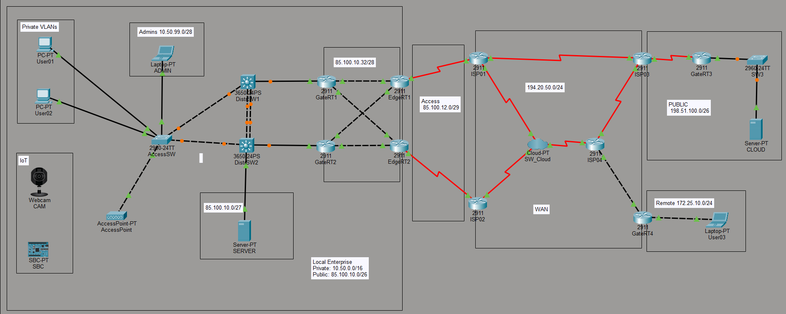

# Lab 00: Przygotowanie Topologii i Adresacji Bazowej (Topology Setup & Base Addressing)

---

## 🇵🇱 Wersja Polska 

### Opis projektu
Inicjalizacja i kompleksowe przygotowanie bazowej topologii sieci rozległej (WAN), która stanowi fundament dla wszystkich zaawansowanych scenariuszy realizowanych w bieżącym semestrze. Projekt integruje segment korporacyjny (Local Enterprise) z architekturą trójwarstwową, sieć rozległą opartego na Service Providerze z chmurą Frame Relay, publiczny segment usługowy oraz oddział zdalny z translacją adresów. Głównym celem było zaprojektowanie unikalnego schematu adresacji VLSM (prywatnej i publicznej), wdrożenie mechanizmów przełączania warstwy 2 oraz redundancji brzegowej.

### Kluczowe zadania i protokoły
- **Projektowanie Adresacji VLSM:** Opracowanie spójnego, w pełni unikalnego schematu adresacji IPv4. Wydzielenie prywatnej klasy A (`10.50.0.0/16`) dla sieci wewnętrznych z odpowiednio dobranymi maskami subnetów (nie krótszymi niż `/24`) oraz publicznego bloku (`85.100.10.0/26`) z zachowaniem ciągłości adresacyjnej dla łączy punkt-punkt i serwerów.
- **Switching i Optymalizacja STP:** Konfiguracja przełączników dostępowych oraz wielowarstwowych Cisco Catalyst 3650. Ręczne wymuszenie hierarchii protokołu drzewa rozpinającego (`Root Primary` i `Root Secondary`) w celu zapewnienia deterministycznej ścieżki routingu.
- **Agregacja Łączy (EtherChannel):** Wdrożenie protokołu LACP w trybie `active` w celu połączenia przełączników dystrybucyjnych redundantnym łączem o zwiększonej przepustowości.
- **Redundancja Bramy Domyślnej (HSRP):** Konfiguracja protokołu Hot Standby Router Protocol na routerach bramowych `GateRT1/2` z ustaleniem priorytetów i funkcją `preempt` dla płynnego przejmowania ruchu w przypadku awarii.
- **Usługi Sieciowe (DHCP & NAT):** Uruchomienie lokalnych serwerów DHCP na routerach bramowych dla dynamicznego przydzielania adresów w segmentach użytkowników i IoT. Implementacja translacji NAT Overload (PAT) na routerze oddziału zdalnego (`GateRT4`) w celu umożliwienia bezpiecznej komunikacji z siecią zewnętrzną.
- **Infrastruktura WAN (Frame Relay & PPP):** Konfiguracja statycznego przełączania ramek na chmurze `SW_Cloud` z mapowaniem identyfikatorów DLCI oraz łączy szeregowych z enkapsulacją PPP.

**Topologia:**

---

## 🇪🇳 English Version 

### Project Description
Initialization and comprehensive setup of a foundational Wide Area Network (WAN) topology, serving as the baseline for all advanced scenarios throughout the current semester. The project integrates an Enterprise segment featuring a three-tier architecture, a Service Provider WAN based on a Frame Relay cloud, a public server segment, and a remote branch utilizing network address translation. The primary objective was to design a unique VLSM addressing scheme (private & public), deploy Layer 2 switching mechanisms, and implement edge redundancy.

### Key Tasks & Protocols
- **VLSM Addressing Design:** Developing a consistent, fully custom IPv4 addressing scheme. Allocating a private Class A space (`10.50.0.0/16`) for internal networks with properly tailored subnet masks (no shorter than `/24`), alongside a public block (`85.100.10.0/26`) maintaining strict address continuity for point-to-point links and servers.
- **Switching & STP Optimization:** Configuring access and multilayer Cisco Catalyst 3650 switches. Manually establishing Spanning Tree Protocol hierarchy (`Root Primary` and `Root Secondary`) to ensure deterministic path selection.
- **Link Aggregation (EtherChannel):** Deploying LACP in `active` mode to bundle distribution switches with high-availability, high-bandwidth links.
- **Gateway Redundancy (HSRP):** Configuring Hot Standby Router Protocol on `GateRT1/2` gateway routers with custom priorities and the `preempt` feature for seamless failover handling.
- **Network Services (DHCP & NAT):** Operating local DHCP servers on gateway routers to dynamically provision user and IoT segments. Implementing NAT Overload (PAT) on the remote branch router (`GateRT4`) to enable secure communication with external networks.
- **WAN Infrastructure (Frame Relay & PPP):** Configuring static frame switching on the `SW_Cloud` with DLCI mapping alongside serial links utilizing PPP encapsulation.

**Topologia:**
